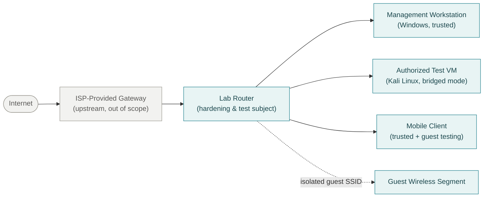

# Secure Home Network Hardening Lab

**Independent, authorized, hands-on IT/cybersecurity portfolio project.**
Deployment, hardening, and validation of a consumer router, with endpoint and
network troubleshooting along the way — documented like a real change record,
including what didn't work and what's still unresolved.

> **Project status: complete for this phase.** The findings below reflect a
> single hardening cycle on personally owned equipment. This is not an active
> production system, not a paid engagement, and not a claim of professional
> penetration-testing experience — see [Project Status](#project-status) for
> the full framing.

---

## Overview

This project takes a consumer-grade router from an unverified default state to
a documented, tested, and hardened configuration — the kind of first real
networking project many IT/security careers start with. The goal wasn't to
simulate an enterprise network; it was to practice the *process* enterprise
teams actually use: verify before you trust, back up before you change,
validate after you change, and write down what you don't know.

Work spanned four layers: the router itself, guest wireless, a bridged VMware
lab client, and the Windows management endpoint — tied together with
Nmap-based scanning and Windows Firewall log correlation.

**Hardware/software used:** NETGEAR Nighthawk XR1000 v1 (DumaOS), an existing
ISP gateway, a Windows workstation, VMware Workstation, and a Kali Linux VM.
Full scope and tooling are in [docs/architecture-and-scope.md](docs/architecture-and-scope.md).

## Outcomes

| Area | Result | Status |
|---|---|---|
| Firmware | Verified against vendor site and manually updated after the built-in updater falsely reported "current" | Remediated |
| Guest network isolation | Internet allowed; access to trusted hosts, router admin, and other guests all blocked — confirmed by testing, not just by a checked box | Validated |
| Router service exposure | Port triggering, DLNA, ReadySHARE (Network Neighborhood/MacShare + local HTTP), and UPnP disabled | Completed |
| Administrative access | HTTPS preferred; HTTP found still reachable — documented as a residual vendor limitation, not silently ignored | Mitigated / residual |
| VM networking | Kali Linux moved from VMware NAT to Bridged mode to act as a real LAN-side test host | Validated |
| Windows Firewall correlation | Inbound drops from the authorized scan matched line-for-line against firewall logs | Validated |
| Endpoint exposure | Two auto-running third-party services and one peer-sharing feature reviewed and disabled after confirming no operational need | Remediated |

## Technical scope

- Controlled factory reset and initial secure configuration (unique admin
  credentials, separate strong-password SSIDs per band)
- Firmware verification against the vendor's own support page and manual,
  change-managed remediation (export backup → verify → apply → confirm →
  re-validate configuration)
- Router service minimization: UPnP, port triggering, DLNA, ReadySHARE
- Guest-network isolation validated through live connectivity testing, not
  just configuration review
- VMware NAT → Bridged migration for a Kali Linux VM, with multi-source asset
  reconciliation (DHCP client list, `arp`, VM adapter state) instead of
  trusting a single tool
- Authorized Nmap-based discovery and service enumeration of the router,
  scoped strictly to the trusted LAN
- HTTPS-enforcement and certificate/TLS review of the router's admin
  interface, including what DumaOS could *not* fix
- Windows Firewall profile hardening and drop-log correlation against the
  Kali scan
- Endpoint service review that found and removed unnecessary listening
  services (Windows Delivery Optimization peer sharing, two bundled
  third-party services)

Full methodology is in [docs/hardening-and-validation.md](docs/hardening-and-validation.md).

## Sanitized conceptual topology

The diagram below is a **generalized concept diagram**, not a reproduction of
the real household network. No real IP ranges, hostnames, or vendor gateway
identity are shown.



This intentionally omits addressing, vendor gateway model/identity, and the
double-NAT staging detail used only for safe experimentation — see
[docs/architecture-and-scope.md](docs/architecture-and-scope.md) for the
reasoning and what the design does and doesn't claim.

## Project status

This repository documents **one completed hardening and validation cycle**,
performed on hardware the author owns and is authorized to administer. It is:

- **Not** a professional penetration test or red-team engagement
- **Not** enterprise infrastructure — this is consumer-grade hardware with
  consumer-grade limits (no VLANs, no centralized logging, no IDS/IPS)
- **Not** a claim of employment or contracted security work
- **An honest record** of deliberate changes, functional validation, and
  documented residual risk on a personally owned lab

## Methodology

1. **Baseline before changing anything** — record the starting configuration
   before touching a setting.
2. **Verify, don't trust a single source** — the router's own updater said it
   was current; the vendor's support site said otherwise.
3. **Change management, not just clicking settings** — back up, apply,
   confirm, re-validate.
4. **Prove controls work — don't just enable them** — guest isolation was
   accepted only after live connectivity tests, not because a checkbox was
   ticked.
5. **Correlate across tools** — Nmap results were checked against Windows
   Firewall logs and PowerShell service/process state instead of trusted in
   isolation.
6. **Document what didn't get fixed** — vendor-side limitations (expired local
   certificate, deprecated TLS versions still offered, HTTP still reachable)
   are recorded as residual risk, not hidden.

Full write-up: [docs/hardening-and-validation.md](docs/hardening-and-validation.md)
and [docs/troubleshooting-and-lessons.md](docs/troubleshooting-and-lessons.md).

## Selected validated controls

- **UPnP disabled**, with an empty port-mapping table confirmed on inspection.
- **Guest wireless isolation** — guests reach the Internet but are blocked from
  trusted hosts, router administration, and each other.
- **Router service minimization** — port triggering, DLNA media server, and
  both ReadySHARE local-sharing methods disabled after confirming no
  operational need.
- **Firmware currency** — manually verified and updated after the built-in
  updater under-reported available versions.
- **Endpoint service reduction** — Windows Delivery Optimization peer sharing
  and two auto-running third-party services stopped, with a Nmap retest
  confirming the corresponding ports moved from open/filtered-with-listener to
  filtered with no listener.

Details, initial state, and validation method for each control are in
[docs/hardening-and-validation.md](docs/hardening-and-validation.md).

## Selected troubleshooting lessons

- **VMware NAT vs. Bridged networking** changes what a device actually looks
  like on the LAN — NAT put the VM behind a second private address space,
  Bridged made it a real peer the router could see and the project could scan
  from.
- **Local browser/site settings can block local admin access** in ways that
  look like a network fault — a Chrome pop-up/redirect permission, not a
  routing issue, was the actual fix.
- **VPN clients can silently break local management access** — a VPN was
  rerouting or blocking LAN traffic to the router's admin interface;
  disconnecting it restored access.
- **A listening port on a host is not the same question as a reachable port
  on the network** — Windows showed local listeners that an external scan
  still reported as filtered, because the host firewall was doing its job.

Full detail: [docs/troubleshooting-and-lessons.md](docs/troubleshooting-and-lessons.md).

## Residual risks and limitations

These were identified, evaluated, and consciously left as documented residual
risk rather than something DumaOS could resolve:

- **HTTP remains reachable** on the router's admin interface even with an
  "always use HTTPS" preference enabled. Mitigation: administer only over
  HTTPS from the trusted LAN; never submit credentials over HTTP.
- **The router's local management certificate had expired**, weakening browser
  identity validation even though the session itself was still encrypted.
- **Deprecated TLS versions (1.0 and 1.1) remain enabled** alongside TLS 1.2,
  with no interface control to disable them.
- **A handful of additional high-numbered TCP listeners** were observed on the
  router during a broader scan. Nmap's own service-identification guesses for
  them were inconsistent and are **not** treated as confirmed findings — they
  are recorded as an open observation requiring vendor-level interpretation.
- **No Internet-side exposure test was performed.** Every scan in this project
  ran from the trusted LAN. This repository does not claim that any listed
  service is reachable from the public Internet.
- **This is consumer-grade hardware.** No VLAN segmentation, centralized
  logging, or IDS/IPS was in scope or available.

## Evidence gallery

A small set of screenshots is included to support specific claims above.
Each one is a genuine original evidence screenshot that has been selectively
blurred/cropped and flattened for publication — narrow blur zones or crops
over addresses, hostnames, SSIDs, credentials, and exact timestamps, with the
real surrounding UI or terminal output left intact. None are recreated
illustrations. See
[assets/screenshots/README.md](assets/screenshots/README.md) for exactly what
was blurred/cropped in each image and why.

| Evidence | Demonstrates |
|---|---|
| [UPnP disabled](assets/screenshots/01-router-upnp-disabled.png) | Router service minimization |
| [Guest network isolation](assets/screenshots/02-guest-network-isolation.png) | Guest SSID configuration with LAN access blocked |
| [Router service enumeration](assets/screenshots/04-router-service-enumeration-summary.png) | Authorized Nmap scan against the router, sensitive fields blurred |
| [Endpoint network profile baseline](assets/screenshots/06-endpoint-network-profile-baseline.png) | Windows endpoint's network profile and firewall-profile baseline (all profiles enabled, default-deny inbound) |

The VM bridged-network validation and Windows Firewall drop-log correlation
steps are documented narratively in
[docs/hardening-and-validation.md](docs/hardening-and-validation.md); their
source screenshots were excluded from the published set on final quality
review — see
[assets/screenshots/README.md](assets/screenshots/README.md#what-was-excluded-and-why).

## Future expansion

- Evaluate the revived [GW-001 / OpenWrt gateway](https://github.com/MReyna22/USG-Revival)
  for a proposed isolated lab deployment, with equipment readiness and validation
  tracked in [SLB Corona Donated Gear](https://github.com/MReyna22/slb-corona-donated-gear).
- A managed switch with real VLAN segmentation
- Additional Windows/Linux VMs and a small internal lab domain
- Centralized logging (e.g., a lightweight SIEM or log shipper)
- An authorized Internet-side exposure test performed from an external network

## Authorization and redaction statement

All testing in this project was performed on hardware and systems owned by the
author or otherwise authorized for the author to administer. No third-party
systems were tested. This repository has been reviewed to remove or generalize
Wi-Fi passwords, administrator credentials, public IP addresses, full MAC
addresses, router serial numbers/PINs, hostnames, usernames, SSIDs,
configuration backups, certificate fingerprints, and exact scan timestamps.
See [docs/publication-safety.md](docs/publication-safety.md) for the complete
breakdown of what was redacted or generalized and why.

## Repository map

```
secure-home-network-lab/
├── README.md
├── SECURITY.md
├── LICENSE
├── docs/
│   ├── architecture-and-scope.md
│   ├── hardening-and-validation.md
│   ├── troubleshooting-and-lessons.md
│   ├── publication-safety.md
│   └── commands-reference.md
└── assets/
    └── screenshots/
        ├── README.md
        └── (sanitized evidence images)
```
